<!-- Generated by scripts/generate.mjs from network.config.json. Edit those, not this file. -->

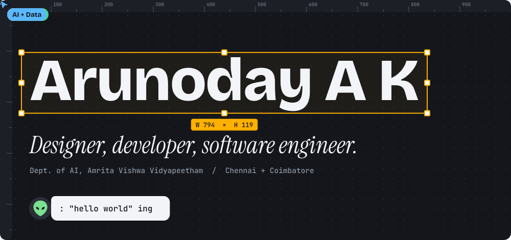


<a href="https://heldygo.com">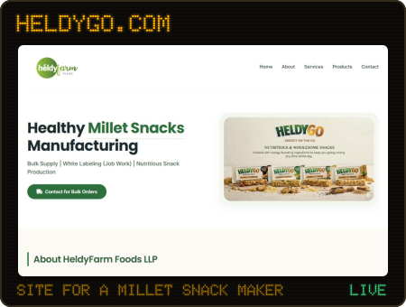</a>
<a href="https://hightechinteriors.in">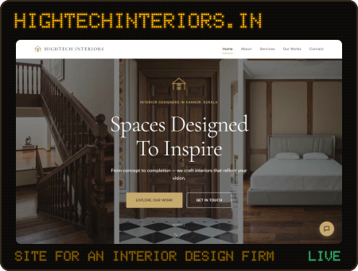</a>

<a href="https://github.com/arooon-n/NUMBAT-TfL-OR">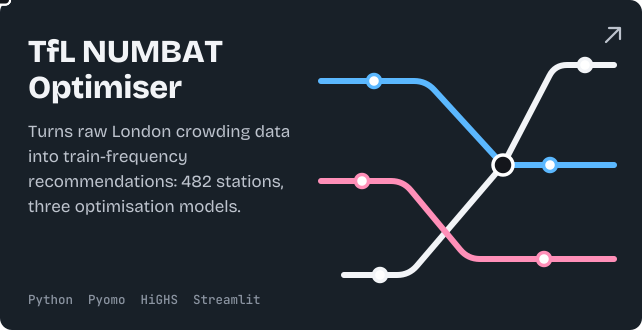</a>
<a href="https://github.com/arooon-n/NeuroGrip">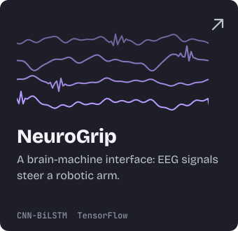</a> 
<a href="https://github.com/arooon-n/AcadEase">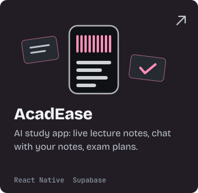</a>
<a href="https://github.com/arooon-n/bitcoin-volatility-analysis">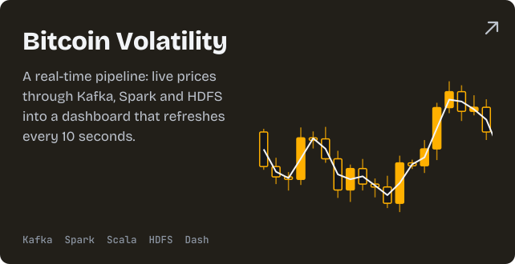</a> 
<a href="https://github.com/arooon-n/SmartRoute-ADMM">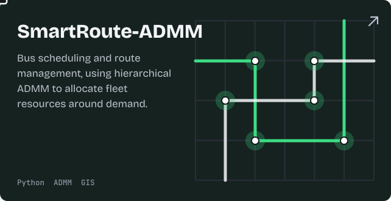</a>
<a href="https://github.com/arooon-n/literature-mining-hydrogen-storage-alloys">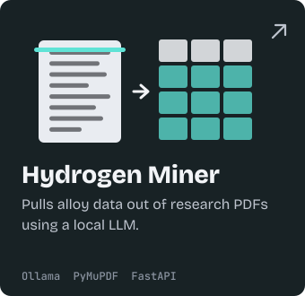</a> 
<a href="https://github.com/arooon-n/Gesture_Controlled_Virtual_Mouse_using_ESP32">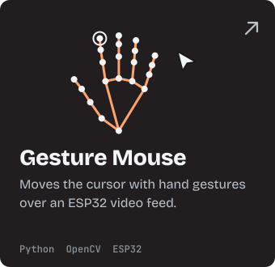</a>
<a href="https://github.com/arooon-n/Hybrid-Statistical-DeepLearning-Model">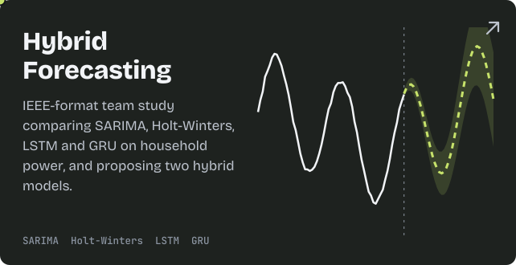</a>

<a href="https://github.com/arooon-n/UniTrade">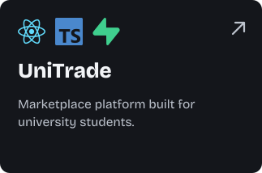</a>
<a href="https://github.com/arooon-n/Amrita_DormDash_UI_Design">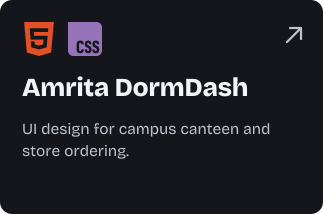</a>
<a href="mailto:akarunoday2005@gmail.com?subject=Design%20work">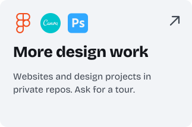</a>

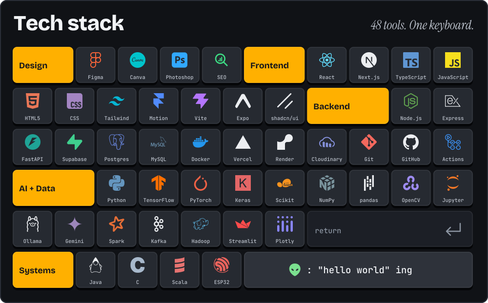

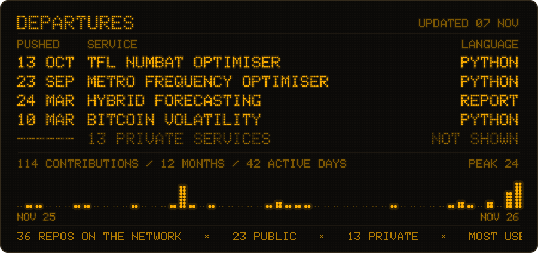

Everything on this page, in plain text

I design websites, build what runs behind them, and make sure people can actually find them. Frontend developer, UI/UX designer and software engineer, also working on AI and data: a brain-controlled robotic arm, and metro networks optimised on real data.

**Live websites**

- [heldygo.com](https://heldygo.com): HeldyFarm Foods LLP | Healthy Millet Snacks Manufacturing
- [hightechinteriors.in](https://hightechinteriors.in): Hightech Interiors | Interior Designers in Kannur, Kerala — Homes, Kitchens & Offices

**Public projects**

- [TfL NUMBAT Optimiser](https://github.com/arooon-n/NUMBAT-TfL-OR): Turns raw London crowding data into train-frequency recommendations: 482 stations, three optimisation models.
- [NeuroGrip](https://github.com/arooon-n/NeuroGrip): A brain-machine interface: EEG signals steer a robotic arm.
- [AcadEase](https://github.com/arooon-n/AcadEase): AI study app: live lecture notes, chat with your notes, exam plans.
- [Bitcoin Volatility](https://github.com/arooon-n/bitcoin-volatility-analysis): A real-time pipeline: live prices through Kafka, Spark and HDFS into a dashboard that refreshes every 10 seconds.
- [SmartRoute-ADMM](https://github.com/arooon-n/SmartRoute-ADMM): Bus scheduling and route management, using hierarchical ADMM to allocate fleet resources around demand.
- [Hydrogen Miner](https://github.com/arooon-n/literature-mining-hydrogen-storage-alloys): Pulls alloy data out of research PDFs using a local LLM.
- [Gesture Mouse](https://github.com/arooon-n/Gesture_Controlled_Virtual_Mouse_using_ESP32): Moves the cursor with hand gestures over an ESP32 video feed.
- [Hybrid Forecasting](https://github.com/arooon-n/Hybrid-Statistical-DeepLearning-Model): IEEE-format team study comparing SARIMA, Holt-Winters, LSTM and GRU on household power, and proposing two hybrid models.
- [UniTrade](https://github.com/arooon-n/UniTrade): Marketplace platform built for university students.
- [Amrita DormDash](https://github.com/arooon-n/Amrita_DormDash_UI_Design): UI design for campus canteen and store ordering.
- [WiseEnergy](https://github.com/arooon-n/WiseEnergy): Next.js and TypeScript app
- [SolarView](https://github.com/arooon-n/nasa-space-apps): animated solar system explorer
- [Epidemic Spread Simulator](https://github.com/arooon-n/epidemic-spread-simulator-using-graphs): disease spread over graphs in C, using Dijkstra, Prim's and greedy strategies
- [Metro Frequency Optimiser](https://github.com/arooon-n/metro-train-frequency-capacity-optimization): decision-support system on TfL NUMBAT data, with scenario analysis
- [Bitcoin Volatility on Spark](https://github.com/arooon-n/bitcoin-volatility-analysis-using-spark): big data pre-processing and volatility analysis
- [NeuroGrip Report](https://github.com/arooon-n/NeuroGrip-Report): project report site for NeuroGrip
- [Space ARS](https://github.com/arooon-n/space-ars): spacecraft reservation system using Python and MySQL
- [P2P File Sharing](https://github.com/arooon-n/P2P_File_Sharing): peer-to-peer file sharing with client, peer and server in Python
- [2D Adventure Game](https://github.com/arooon-n/2D_Adventure_game_in_Java): tile-based game in Java with entities and monsters
- [Emotion Detection](https://github.com/arooon-n/realtime_emotion_detection_using_CNN): real-time emotion recognition with a CNN
- [Protein Interaction ML](https://github.com/arooon-n/ML_Model_for_predicting_protein_protein_interaction): predicting protein-protein interactions
- [Hangman in Jack](https://github.com/arooon-n/Hangman_Game_in_Jack): Hangman written in the Jack language

**Tech stack**

Figma, Canva, Photoshop, SEO, React, Next.js, TypeScript, JavaScript, HTML5, CSS, Tailwind, Motion, Vite, Expo, shadcn/ui, Node.js, Express, FastAPI, Supabase, Postgres, MySQL, Docker, Vercel, Render, Cloudinary, Git, GitHub, Actions, Python, TensorFlow, PyTorch, Keras, Scikit, NumPy, pandas, OpenCV, Jupyter, Ollama, Gemini, Spark, Kafka, Hadoop, Streamlit, Plotly, Java, C, Scala, ESP32

**Contact**

- [LinkedIn](https://www.linkedin.com/in/arunoday-a-k/): arunoday-a-k
- [Instagram](https://www.instagram.com/arooon__n): arooon__n
- [Mail](mailto:akarunoday2005@gmail.com): akarunoday2005@gmail.com

