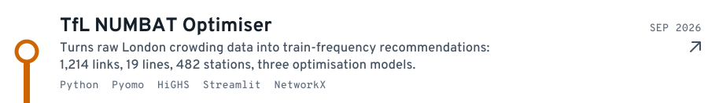
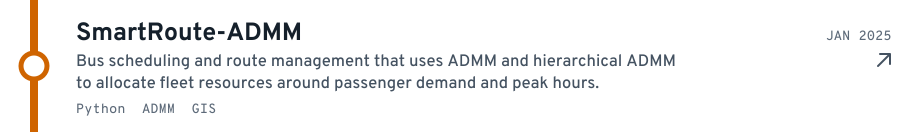
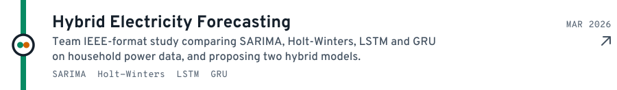
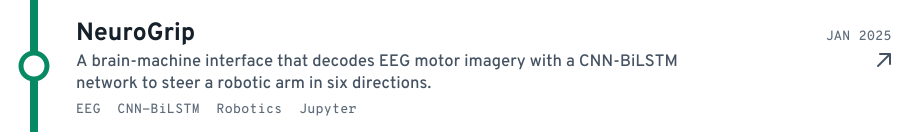
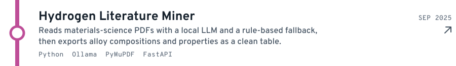
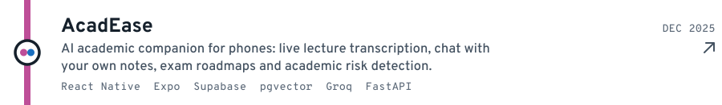
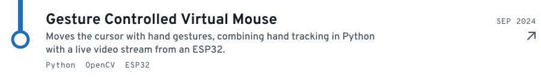

<!-- Generated by scripts/generate.mjs from network.config.json. Edit those, not this file. -->

<picture><source media="(prefers-color-scheme: dark)" srcset="assets/hero-dark.svg"><source media="(prefers-color-scheme: light)" srcset="assets/hero-light.svg"></picture>

I build systems that turn messy, real-world data into decisions, from metro and bus networks to live market streams, plus a robotic arm steered by EEG signals and AI tools that people can use on their phones. This profile is drawn as a network: each line is a discipline and each station is a real project.

**35 repositories, 23 of them public.** My strongest work often lives on the private line, so what you see here is only part of the map.

## Stations worth stopping at

<a href="https://github.com/arooon-n/NUMBAT-TfL-OR"><picture><source media="(prefers-color-scheme: dark)" srcset="assets/station-numbat-dark.svg"><source media="(prefers-color-scheme: light)" srcset="assets/station-numbat-light.svg"></picture></a> 
<a href="https://github.com/arooon-n/SmartRoute-ADMM"><picture><source media="(prefers-color-scheme: dark)" srcset="assets/station-smartroute-dark.svg"><source media="(prefers-color-scheme: light)" srcset="assets/station-smartroute-light.svg"></picture></a> 
<a href="https://github.com/arooon-n/bitcoin-volatility-analysis"><picture><source media="(prefers-color-scheme: dark)" srcset="assets/station-bitcoin-dark.svg"><source media="(prefers-color-scheme: light)" srcset="assets/station-bitcoin-light.svg"></picture></a> 
<a href="https://github.com/arooon-n/Hybrid-Statistical-DeepLearning-Model"><picture><source media="(prefers-color-scheme: dark)" srcset="assets/station-hybrid-dark.svg"><source media="(prefers-color-scheme: light)" srcset="assets/station-hybrid-light.svg"></picture></a> 
<a href="https://github.com/arooon-n/NeuroGrip"><picture><source media="(prefers-color-scheme: dark)" srcset="assets/station-neurogrip-dark.svg"><source media="(prefers-color-scheme: light)" srcset="assets/station-neurogrip-light.svg"></picture></a> 
<a href="https://github.com/arooon-n/literature-mining-hydrogen-storage-alloys"><picture><source media="(prefers-color-scheme: dark)" srcset="assets/station-hydrogen-dark.svg"><source media="(prefers-color-scheme: light)" srcset="assets/station-hydrogen-light.svg"></picture></a> 
<a href="https://github.com/arooon-n/AcadEase"><picture><source media="(prefers-color-scheme: dark)" srcset="assets/station-acadease-dark.svg"><source media="(prefers-color-scheme: light)" srcset="assets/station-acadease-light.svg"></picture></a> 
<a href="https://github.com/arooon-n/Gesture_Controlled_Virtual_Mouse_using_ESP32"><picture><source media="(prefers-color-scheme: dark)" srcset="assets/station-gesture-dark.svg"><source media="(prefers-color-scheme: light)" srcset="assets/station-gesture-light.svg"></picture></a> 

## Live departures

Real activity from this account, refreshed every week by a GitHub Action.

## Line guide

| Line | What runs on it |
|:---|:---|
| **Data & Optimisation** | Python, Pyomo, HiGHS, ADMM, graph algorithms, Streamlit, NetworkX, Kafka, Spark, Scala, HDFS, Docker, Dash |
| **Applied AI** | Groq, Gemini, Whisper, Ollama, RAG with pgvector, FastAPI, PyMuPDF |
| **Machine Learning** | CNN-BiLSTM, EEG decoding, LSTM, GRU, CNNs, SARIMA, Holt-Winters, Jupyter |
| **Product & Systems** | TypeScript, React, React Native, Expo, Next.js, Supabase, Tailwind, Java, C, OpenCV, ESP32 |

<b>Every public stop, in plain text</b>

- [TfL NUMBAT Optimiser](https://github.com/arooon-n/NUMBAT-TfL-OR): Optimises metro frequency on real TfL data
- [SmartRoute-ADMM](https://github.com/arooon-n/SmartRoute-ADMM): Bus scheduling with ADMM optimisation
- [Bitcoin Volatility Pipeline](https://github.com/arooon-n/bitcoin-volatility-analysis): Real-time streaming analytics pipeline
- [Hybrid Electricity Forecasting](https://github.com/arooon-n/Hybrid-Statistical-DeepLearning-Model): Statistical + deep learning forecasting study
- [NeuroGrip](https://github.com/arooon-n/NeuroGrip): EEG-controlled robotic arm
- [Hydrogen Literature Miner](https://github.com/arooon-n/literature-mining-hydrogen-storage-alloys): LLM extraction from research papers
- [AcadEase](https://github.com/arooon-n/AcadEase): AI study companion for Android
- [Gesture Controlled Virtual Mouse](https://github.com/arooon-n/Gesture_Controlled_Virtual_Mouse_using_ESP32): Hand-tracking mouse using an ESP32
- [Epidemic Spread Simulator](https://github.com/arooon-n/epidemic-spread-simulator-using-graphs): disease spread over graphs in C, using Dijkstra, Prim's and greedy strategies, with adjacency list and matrix runtimes compared
- [Metro Frequency Optimiser](https://github.com/arooon-n/metro-train-frequency-capacity-optimization): decision-support system on TfL NUMBAT data, with run manifests and scenario analysis
- [UniTrade](https://github.com/arooon-n/UniTrade): university marketplace platform built with React, TypeScript and Supabase
- [WiseEnergy](https://github.com/arooon-n/WiseEnergy): Next.js and TypeScript app
- [Bitcoin Volatility on Spark](https://github.com/arooon-n/bitcoin-volatility-analysis-using-spark): big data pre-processing and volatility analysis
- [NeuroGrip Report](https://github.com/arooon-n/NeuroGrip-Report): project report site for NeuroGrip
- [Space ARS](https://github.com/arooon-n/space-ars): spacecraft reservation system using Python and MySQL
- [P2P File Sharing](https://github.com/arooon-n/P2P_File_Sharing): peer-to-peer file sharing with client, peer and server in Python
- [SolarView](https://github.com/arooon-n/nasa-space-apps): animated solar system explorer
- [Emotion Detection](https://github.com/arooon-n/realtime_emotion_detection_using_CNN): real-time emotion recognition with a CNN
- [Protein Interaction ML](https://github.com/arooon-n/ML_Model_for_predicting_protein_protein_interaction): predicting protein-protein interactions
- [2D Adventure Game](https://github.com/arooon-n/2D_Adventure_game_in_Java): tile-based game in Java with entities and monsters
- [Hangman in Jack](https://github.com/arooon-n/Hangman_Game_in_Jack): Hangman written in the Jack language
- [Amrita DormDash](https://github.com/arooon-n/Amrita_DormDash_UI_Design): UI design project

<code>: &quot;hello world&quot; ing</code> 👽

