<!-- Generated by scripts/generate.mjs from network.config.json. Edit those, not this file. -->

 
<a href="https://www.linkedin.com/in/arunoday-a-k/">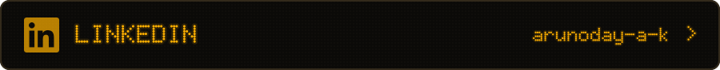</a> 
 
 

**Frontend developer, UI/UX designer and software engineer.** I design and build websites, apps and the systems behind them, and I handle the SEO so people can actually find them. My background in AI and data shows up in everything from a brain-controlled robotic arm to metro network optimisation.

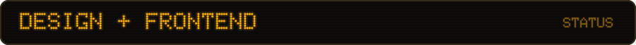 
<a href="https://github.com/arooon-n/AcadEase">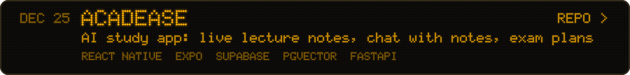</a> 
<a href="https://github.com/arooon-n/UniTrade">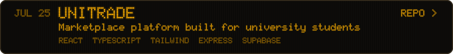</a> 
<a href="https://github.com/arooon-n/Amrita_DormDash_UI_Design">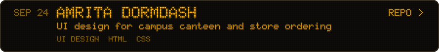</a> 
<a href="mailto:akarunoday2005@gmail.com?subject=Design%20work">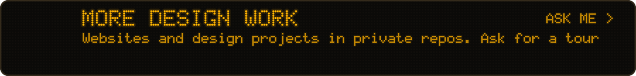</a> 

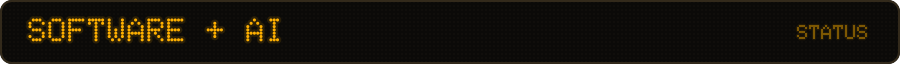 
<a href="https://github.com/arooon-n/NUMBAT-TfL-OR">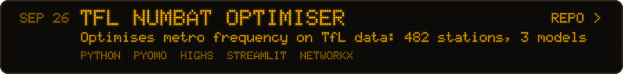</a> 
<a href="https://github.com/arooon-n/NeuroGrip">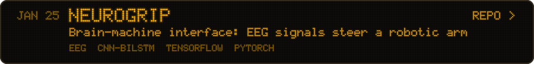</a> 
<a href="https://github.com/arooon-n/bitcoin-volatility-analysis">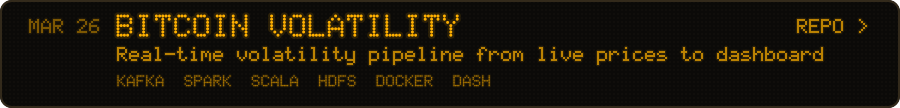</a> 
<a href="https://github.com/arooon-n/SmartRoute-ADMM">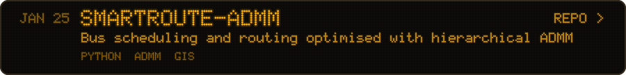</a> 
<a href="https://github.com/arooon-n/Hybrid-Statistical-DeepLearning-Model">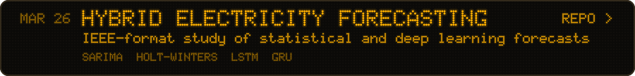</a> 
<a href="https://github.com/arooon-n/literature-mining-hydrogen-storage-alloys">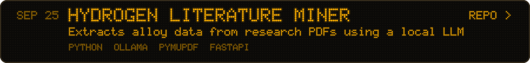</a> 
<a href="https://github.com/arooon-n/Gesture_Controlled_Virtual_Mouse_using_ESP32">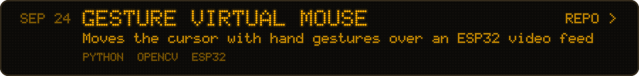</a> 


Many of my design projects live in private repos. Ask me for a walkthrough. The board above updates itself every week from this account.

<b>Everything on this page, in plain text</b>

**Live websites**

- [heldygo.com](https://heldygo.com): the website for HeldyFarm Foods, a millet snack manufacturer. Design, build and SEO.
- [hightechinteriors.in](https://hightechinteriors.in): the website for Hightech Interiors, an interior design firm in Kannur. Design, build and SEO.

**Public projects**

- [ACADEASE](https://github.com/arooon-n/AcadEase): AI study app: live lecture notes, chat with notes, exam plans
- [UNITRADE](https://github.com/arooon-n/UniTrade): Marketplace platform built for university students
- [AMRITA DORMDASH](https://github.com/arooon-n/Amrita_DormDash_UI_Design): UI design for campus canteen and store ordering
- [TFL NUMBAT OPTIMISER](https://github.com/arooon-n/NUMBAT-TfL-OR): Optimises metro frequency on TfL data: 482 stations, 3 models
- [NEUROGRIP](https://github.com/arooon-n/NeuroGrip): Brain-machine interface: EEG signals steer a robotic arm
- [BITCOIN VOLATILITY](https://github.com/arooon-n/bitcoin-volatility-analysis): Real-time volatility pipeline from live prices to dashboard
- [SMARTROUTE-ADMM](https://github.com/arooon-n/SmartRoute-ADMM): Bus scheduling and routing optimised with hierarchical ADMM
- [HYBRID ELECTRICITY FORECASTING](https://github.com/arooon-n/Hybrid-Statistical-DeepLearning-Model): IEEE-format study of statistical and deep learning forecasts
- [HYDROGEN LITERATURE MINER](https://github.com/arooon-n/literature-mining-hydrogen-storage-alloys): Extracts alloy data from research PDFs using a local LLM
- [GESTURE VIRTUAL MOUSE](https://github.com/arooon-n/Gesture_Controlled_Virtual_Mouse_using_ESP32): Moves the cursor with hand gestures over an ESP32 video feed
- [WiseEnergy](https://github.com/arooon-n/WiseEnergy): Next.js and TypeScript app
- [SolarView](https://github.com/arooon-n/nasa-space-apps): animated solar system explorer
- [Epidemic Spread Simulator](https://github.com/arooon-n/epidemic-spread-simulator-using-graphs): disease spread over graphs in C, using Dijkstra, Prim's and greedy strategies
- [Metro Frequency Optimiser](https://github.com/arooon-n/metro-train-frequency-capacity-optimization): decision-support system on TfL NUMBAT data, with scenario analysis
- [Bitcoin Volatility on Spark](https://github.com/arooon-n/bitcoin-volatility-analysis-using-spark): big data pre-processing and volatility analysis
- [NeuroGrip Report](https://github.com/arooon-n/NeuroGrip-Report): project report site for NeuroGrip
- [Space ARS](https://github.com/arooon-n/space-ars): spacecraft reservation system using Python and MySQL
- [P2P File Sharing](https://github.com/arooon-n/P2P_File_Sharing): peer-to-peer file sharing with client, peer and server in Python
- [2D Adventure Game](https://github.com/arooon-n/2D_Adventure_game_in_Java): tile-based game in Java with entities and monsters
- [Emotion Detection](https://github.com/arooon-n/realtime_emotion_detection_using_CNN): real-time emotion recognition with a CNN
- [Protein Interaction ML](https://github.com/arooon-n/ML_Model_for_predicting_protein_protein_interaction): predicting protein-protein interactions
- [Hangman in Jack](https://github.com/arooon-n/Hangman_Game_in_Jack): Hangman written in the Jack language

**Tech stack**

- **DESIGN + FRONTEND:** FIGMA, REACT, NEXT.JS, TYPESCRIPT, JAVASCRIPT, HTML5, CSS, TAILWIND, MOTION, VITE, EXPO, SHADCN/UI, SEO
- **BACKEND + DEVOPS:** NODE.JS, EXPRESS, FASTAPI, SUPABASE, POSTGRES, MYSQL, DOCKER, VERCEL, RENDER, CLOUDINARY, GIT, GITHUB, ACTIONS
- **AI + DATA:** PYTHON, TENSORFLOW, PYTORCH, KERAS, SCIKIT, NUMPY, PANDAS, OPENCV, JUPYTER, OLLAMA, GEMINI, SPARK, KAFKA, HADOOP, STREAMLIT, PLOTLY
- **SYSTEMS:** JAVA, C, SCALA, ESP32

<code>: &quot;hello world&quot; ing</code> 👽

